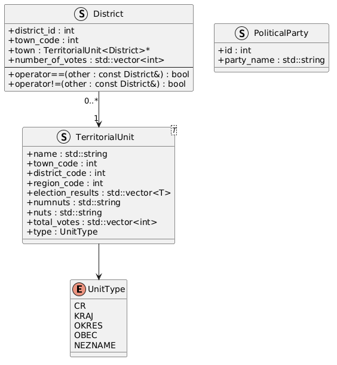
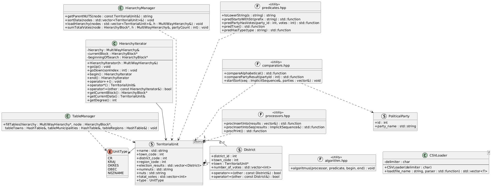
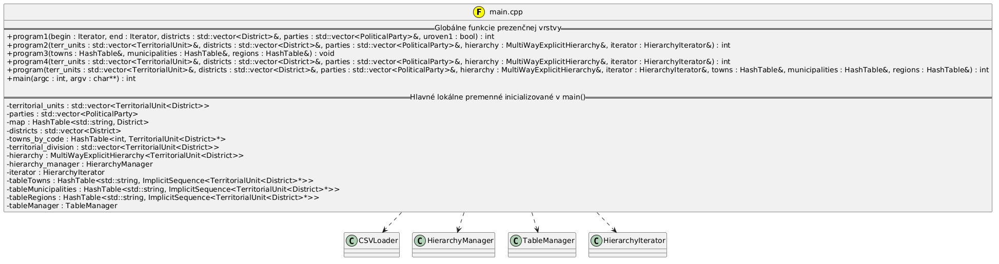
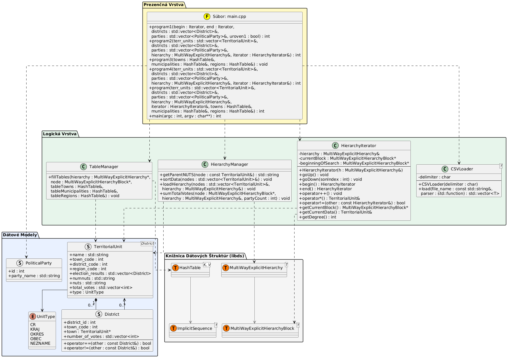
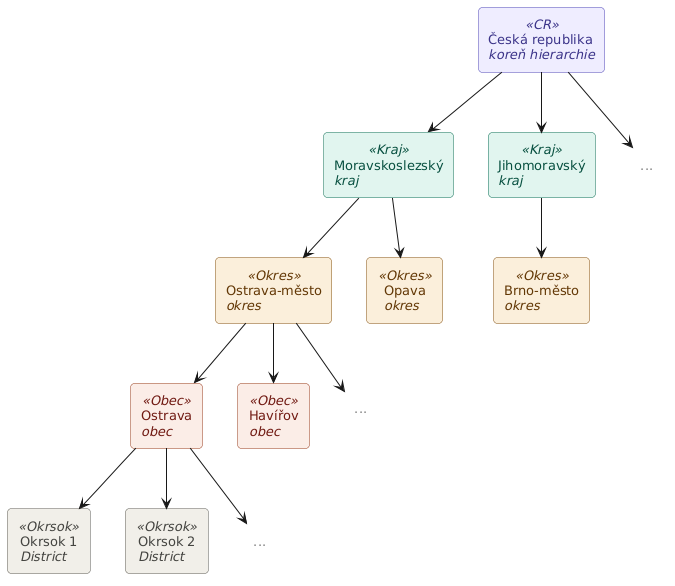
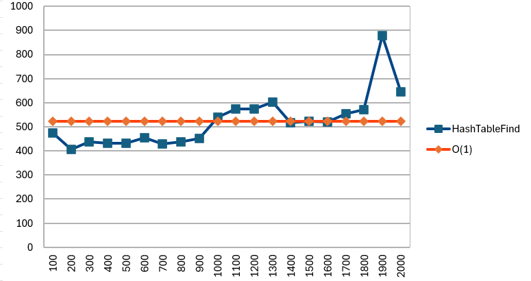
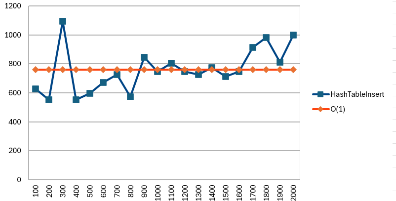
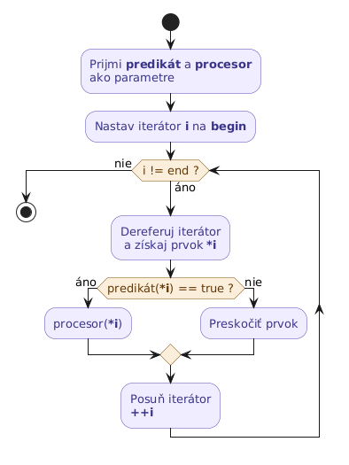

\pagebreak

# Návrh aplikácie
Program je navrhnutý ako konzolová aplikácia, ktorá spracováva údaje o volebných výsledkoch strán pre voľby do Poslaneckej snemovne Parlamentu Českej republiky za rok 2025. Aplikácia je naprogramovaná v programovacom jazyku C++ s dôrazom na princípy objektovo-orientovaného programovania s jasným oddelením zopovedností.

Aplikácia je rozdelná do troch hlavných vrstiev:

**1. Dátová vrstva:** 
  - štruktúra `TerritorialUnit<T>` reprezetuje územnú jednotku na ľubovoľnej úrovni (čr, obec, okres, kraj),
  - štruktúra `District` reprezentuje volebný okrsok obce,
  - štruktúra `PoliticalParty` reprezentuje politickú stranu, ktorá kandidovala do Poslaneckej snemovne.

  {width=35% height=30%}

**2. Logická vrstva** - zabezpečuje algoritmické operácie nad dátami:
  - `CSVLoader` spracováva vstupné dáta z .csv súborov, 
  - `HierarchyManager` buduje a zoskupuje údaje do stromovej štruktúry,
  - `TableManager` indexuje uzly hierarchie pre rýchly prístup,
  - moduly predikátov, procesorov a komparátorov umožňujú funkcionálne filtrovanie a triedenie pomocou lambda výrazov.

  {width=100% height=40%}

**3. Prezenčná vrstva:**
  - zabezpečuje interakciu s používateľom prostredníctvom textového menu,
  - riadi beh programu v `main.cpp`.

  {width=80% height=20%}

## UML
{width=100% height=60%}

\pagebreak
 
# Použité údajové štruktúry
Táto kapitola sa zaoberá jednotlivými údajovými štruktúrami použitými pri tvorbe aplikácie pre semestrálnu prácu z predmetu AUS1. Obsahuje ich opis, určenie ich výhod a nevýhod a zdôvodnenie ich výberu vo všeobecnosti, ako aj z pohľadu ich časovej a pamäťovej zložitosti.

## Prebraté údajové štruktúry
Implementácia nasledujúcich údajových štruktúr je prebratá z cvičení:
  - `MultiWayExplicitHierarchy`
  - `HashTable`
  - `ImplicitSequence`
  - `MergeSort`

## MultiWayExplicitHierarchy
`MultiWayExlpicitHierarchy` je viaccestná explicitná údajová štruktúra (strom), v ktorej môže mať každý rodičovský vrchol ľubovoľný počet synov. V semestrálnej práci som využila túto štruktúra na reprezentáciu vzťahov medzi územnými celkami Českej republiky (ČR).

Medzi územné celky ČR patrí: štát, kraje, okresy a obce. Takéto územné členenie sa dá popísať vzťahom štát -> kraj -> okres -> obec, ktorý vykazuje striktne hierarchický charakter typu „jeden rodič má viacero synov“. Z tohto dôvodu som zvolila štruktúru `MultiWayExplicitHierarchy`, lebo bola prirodzenou a najvhodnejšou voľbou pre modelovanie tejto situácie.

{width=70% height=40%}

**Výhody a nevýhody:**
  - *Výhody:*
    - veľmi dobre mapuje reálne hierarchické vzťahy medzi územnými celkami ČR,
    - vďaka ukladaniu explicitných smerníkov na synov a rodičov je pohyb po hierarchii veľmi rýchly,
    - umožňuje ľahkú implementáciu algoritmov na prechádzanie (napr. `PostOrder` alebo `PreOrder`).

  - *Nevýhody:*
    - vyžaduje vyššiu pamäťovú réžiu z dôvodu nútnosti ukladania smerníkov susedných uzlov v každom bloku.

**Časová a pamäťová zložitosť:**
  - *Časová zložitosť:*
    - operácie navigácie a prístupu k synovi (`accessSon()`) alebo rodičovi (`accessParent()`) pracujú v konštantnom čase O(1),
    - algoritmus na zratávanie celkových výsledkov v každom vrchole (`sumTotalVotes()`) prechádza celý strom rekurzívne, pričom každý uzol navštívi práve raz, čo zodpovedá lineárnej časovej zložitosti O(n), kde n je celkový počet územných celkov.

  - *Pamäťová zložistosť:*
    - pamäťová zložitosť je O(n).

## HashTable
Ďaľšou prebratou údajoiviu štruktúrou z cvičnia je `HashTable`. Je to tabuľka s rozptýlenými záznamami, ktorá mapuje unikátne kľúče na im prisluchajúce hodnoty - indexy. V aplikícii využívam `HashTable` na okamžité vyhľadávanie územných jednotiek podľa ich textového názvu. Mám vytvorené 3 samostatné inštancie pre každý typ územného celku (`tableTowns` pre obce, `tableMunicipalities` pro okresy a `tableRegions` pre kraje).

**Výhody a nevýhody:**
  - *Výhody:*
    - `HashTable` poskytuje extrémne rýchly prístup k prvkom na základe kľúča.

  - *Nevýhody:*
    - pri nevhodnej hešovacej funkcie môže dochádzať ku kolíziám (synonymám), ktoré je potrebné dodatočne riešiť.

**Časová a pamäťová zložitosť:**
  - *Časová zložitosť:*
    - Operácia vkladania (`insert()`) a operácia skús nájsť (`tryFind()`) nadobúda konštatnú časovú zložitosť O(1). V nepriaznivom prípade by sa mohla zhoršiť na lineárnu zložitosť O(n).

    {width=70% height=30%}

    {width=70% height=30%}

  - *Pamäťová zložistosť:*
    - pamäťová zložitosť je lineárna O(n+m), kde n je počet vložených prvkov a m je veľkosť vnútorného poľa tabuľky vrátane dostupnej kapacity.

## ImplicitSequence
`ImplicitSequence` (implicitná sekvencia) je lineárna údajová štruktúra, ktorá ukladá prvky v pamäti v súvislom bloku za sebou. V semestrálnej práci som túto štruktúra využila na plnenie dvoch úloh: 

- *Riešenie synonymických názvov v tabuľkách s rozptýlenými záznamami:* 
  - V ČR existuje veľké množstvo obcí s identickými názvami územených celkov. Ak by som hodnotu v rozptyľovacej tabuľke ukladala ako samotnú inštanciu, pri každom vkladaní novšej jednotky s rovnakým názvom kľúča, by som si tú predchádzajúcu prepísala tou novou. Preto pre riešenie tohto problému využívam `ImplicitSequence`. Ak metóda `tryFind()` zistí, že daný názov už v tabuľke existuje, smerník na novú rovnomennú jednotku sa pomocou operácie `emplaceLast()` vloží na koniec tejto sekvencie. To umožňuje uchovať všetky duplicity bez straty dát.

- *Efektívnu prípravu dát pre triediace algoritmy:* 
  - Štruktúru ImplicitSequence ďalej využívam na ukladanie vyfiltrovaných a vytriedaných záznamov v 4. úrovni semestrálnej práce. Táto štruktúra garantuje uloženie prvkov v pamäti bezprostredne vedľa seba a algoritmus dokáže k prvkom pristupovať cez indexy v konštantnom čase.

**Výhody a nevýhody:**
  - *Výhody:*
    - okamžitý prístup k ľubovoľnému prvku prostredníctvom indexu.

  - *Nevýhody:*
    - môže dojsť k prekročeniu kapacity a k potrebe riešenia tohto problému.

**Časová a pamäťová zložitosť:**
  - *Časová zložitosť:*
    - Prístup k prvku cez index a pridanie prvku na koniec sekvencie (`emplaceLast()`) pracujú v konštantnom čase O(1). Vyhľadávanie konkrétneho synonymického prvku v sekvencii prebieha lineárne so zložitosťou O(k), kde k je malý počet prvkov s rovnakým názvom.

  - *Pamäťová zložistosť:*
    - Pamäťová zložitosť je lineárna O(n). Štruktúra alokuje presne toľko miesta, koľko prvkov sa v nej nachádza.

## MergeSort
`MergeSort` (triedenie zlučovaním) je porovnávací triediaci algoritmus založený na princípe rozdeľ a panuj. V semestrálnej práci som ho využila na triedenie vyfiltrovaných územných jednotiek v 4. úrovni podľa zvoleného komparátora.

Algoritmus rekurzívneho rozdeľuje vstupnú sekvenciu na dve polovice, každú z nich zoradí samostatne a výsledné zoradené časti následne zlúči do jednej výslednej sekvencie.

**Výhody a nevýhody:**
  - *Výhody:*
    - garantovaná časová zložitosť O(n*log(n)) v každom prípade (najlepší, priemerný aj najhorší),
    - stabilný algoritmus - zachováva relatívne poradie rovnakých prvkov,
    - komparátor je odovzdávaný ako lambda funkcia, čo umožňuje zmeniť kritérium triedenia bez zásahu do kódu algoritmu.

  - *Nevýhody:*
    - vyžaduje dodatočnú pamäť O(n) pre pomocnú sekvenciu pri zlučovaní.

**Časová a pamäťová zložitosť:**
  - *Časová zložitosť:*
    - algoritmus rozdeľuje sekvenciu n prvkov na log(n) úrovní, pričom na každej úrovni prebieha zlučovanie v čase O(n). Celková časová zložitosť je teda O(n*log(n)) vo všetkých prípadoch.

  - *Pamäťová zložitosť:*
    - pamäťová zložitosť je O(n) z dôvodu potreby pomocného priestoru pri zlučovaní dvoch zoradených polovíc.

\pagebreak

# Ďalšie požiadavky
## Úpravy vstupných súborov

Pri príprave vstupných dát som vykonala nasledujúce úpravy:

**strany.csv** – pôvodný súbor neobsahoval hlavičkový riadok. Hlavička som doplnenila manuálne. Zároveň som pre potrebu prehľadnosti výpisu pridala stĺpec so skrátenými názvamy polických strán, keďže mnohé strany ich mali až príliš dlhé alebo obsahovali samotné programy politických strán:

```
VYLOS_CIS;NAZEV_STRN;NAZEV_STRN_SKRT
```

**pscoco.csv** – riadky prislúchajúce Prahe mali v stĺpcoch `KRAJ` aj `OKRES` zhodne hodnotu `1100`, keďže Praha tvorí zároveň kraj aj okres. V súbore `cnumnuts.csv` je okres Prahy vedený pod kódom `1199`. Z tohto dôvodu boli v súbore pscoco.csv všetky hodnoty `1100` v stĺpci `OKRES` pre pražské riadky prepísané na `1199`, aby sa správne priradili k príslušnému uzlu v hierarchii.

**cnumnuts.csv** – súbor obsahoval pre oblasť "Zahraničí" iba záznamy na úrovni regiónu, kraja a obcí. Záznam pre okres chýbal, čo znemožňovalo správne zostavenie hierarchie. Chýbajúci riadok okresu som doplnila manuálne:

```
9999;"CZZZZZ";"Zahraničí";109;"CZZZZZ"
```

## Úroveň 1
V tejto podkapitole špecifikujem a  popisujem architektonické a funkčné požiadavky 1. úrovne zadania semestrálneho projektu, ktoré som implementovala v rámci riešenia. Tieto požiadavky sa týkajú najmä návrhu dátového modelu, konštrukcie univerzálneho algoritmu a celkového správania používateľského rozhrania aplikácie.

### Dátový model a efektivita načítania dát
Všetky údaje o výsledkoch volieb sú uložené v jedinej sekvenčnej priamej štruktúre zo štandardnej knižnice `std::vector<TerritorialUnit<District>>`. Načítanie z .csv súborov je navrhnuté efektívne, tak, že každý zdrojový súbor (pscoco.csv, cvs.csv, pst4p.csv, strany.csv) program otvára práve raz a každý riadok spracuje maximálne jedenkrát.  

Z hľadiska objektovej hierarchie som vytvorila struct `TerritorialUnit<T>` (Územná jednotka), `District` (Okrsok) a `PoliticalParty` (Politická strana):  
  - **`TerritorialUnit<T>`:** eviduje názov, kód obce, kód okresu, kód kraja, nuts a numnuts kód, typ a `std::vector<District>`.  
  - **`District`:** obsahuje číslo okrsku, konkrétne volebné výsledky strán a spätný ukazovateľ na materskú obec, čo umožňuje obojsmernú navigáciu.  
  - **`PoliticalParty`:** slúži na ukladanie informácií o politicej strane, ako je jej vylosované id alebo názov.

### Návrh a architektúra univerzálneho algoritmu
Univerzálny algoritmus na filtrovanie dát je striktne zapuzdrený v samostatnej dedikovanej triede, čím je nezávislý od zvyšku projektu. Algoritmus je naprogrmovaný tak, že neprijíma priamo konkrétny kontajner, ale pracuje nad univerzálnym párom iterátorov (begin a end) pomocou šablón (templates). Riadenie algoritmu prebieha zvonku bez nutnosti zásahu do jeho kódu, a to prostredníctvom dvoch parametrov: predikátu (funkcia filtra) a procesora (funkcia spracovania).

{width=40% height=30%}

### Implementácia predikátov a procesorov
Pre potreby prvej úrovne som implementovala predikáty a procesory typu `std::function` pomocou lambda funkcií. Patria sem:  
  - **Procesory (`std::function<void(T&)>`):** 
    - procInsertInto - slúži na vloženie vyfiltrovaného objektu do novej štruktúry,
    - procPrint - formátuje výpis na štandardný výstup.  
  
  - **Predikáty (`std::function<bool(const T&)>`):**
    - predStartsWithStr - filtruje podľa začiatočných písmen obce, 
    - predPartyHasVotes - slúži na kontrolu minimálneho počtu hlasov strany vo všetkých okrskoch obce,
    - predTrue - univerzálny filter vracajúci vždy true pre potreby kompletného výpisu. 

### Správanie používateľského rozhrania
Používateľské rozhranie funguje v uzavretej slučke textového menu. Počiatočné načítanie dát prebehne automaticky pri štarte, pričom následná opakovaná filtrácia už nevyžaduje reštart programu ani opätovné čítanie súborov z disku. Rozhranie je používateľsky prívetivé a plne podporuje kódovanie UTF-8 pre korektnú prácu s diakritikou. Viac sa dočítate v kapitole Používateľká príručka.

## Úroveň 2
V tejto podkapitole popisujem architektonické a funkčné požiadavky úrovne 2, ktoré sa zameriavajú na transformáciu dátového modelu do hierarchickej štruktúry a implementáciu funkčného iterátora.

### Efektívna tvorba hierarchie územných jednotiek
Hlavnou požiadavkou tejto úrovne bolo usporiadanie načítaných dát o volebných výsledkoch do viaccestného stromu reprezentujúceho územné členenie ČR. Na tento účel som implementovala triedu HierarchyManager, ktorá pracuje nad údajovou štruktúrou `MultiWayExplicitHierarchy< TerritorialUnit<District>>`.

Do modelu pribudlo spracovanie číselníka cnumnuts.csv. 

Hierarchia je budovaná s maximálnou časovou efektivitou O(n), pričom každý riadok nového súboru sa spracuje iba raz a uzly sú vkladané v konštantnom čase. Výsledný strom rešpektuje predpísané štyri úrovne:
  - **Koreň** - pomyselný vrchol reprezentujúci celú Českú republiku (typ `UnitType::CR`),
  - **1. úroveň synov** - vrcholy reprezentujúce kraje (`UnitType::KRAJ`),
  - **2. úroveň synov** - vrcholy reprezentujúce okresy (`UnitType::OKRES`),
  - **3. úroveň synov** - vrcholy reprezentujúce samotné obce (`UnitType::OBEC`).

### Ščitávanie výsledkov a obojsmerná navigácia
Keďže primárne dáta o hlasoch boli načítané len na úrovni obcí (resp. okrskov), implementovala som sčítavanie hlasov smerom od spodu nahor po strome. Metóda `sumTotalVotes` prechádza hierarchiu a automaticky sčítava počty hlasov pre jednotlivé politické strany od obcí cez okresy a kraje až do koreňa za celú republiku.

Každý uzol typu `District` si navyše zachováva spätný ukazovateľ na svoju materskú územnú jednotku, čo v kombinácii s pointermi v stromovej štruktúre od libds zaručuje plnú obojsmernú navigáciu v celom dátovom modeli.

### Implementácia iterátora a znovupoužiteľnosť algoritmu
Pre potreby prechádzania vytvorenej hierarchie som implementovala triedu `HierarchyIterator`. Tento iterátor zapuzdruje logiku prechodu stromom (prehliadku) a správa sa ako štandardný iterátor, čo umožňuje sekvenčný prístup k jednotlivým uzlom bez ohľadu na ich hĺbku.

Z hľadiska znovupoužiteľnosti kódu som univerzálny algoritmus navrhnutý v úrovni 1 použila v tejto úrovni priamo a bez akejkoľvek zmeny. Do algoritmu sú ako parametre poslané metódy begin a end vytvoreného `HierarchyIterator-a`. Algoritmus tak dokáže bez modifikácie filtrovať a spracovávať dáta nielen nad pôvodným lineárnym vektorom, ale aj nad komplexnou hierarchickou štruktúrou.

## Úroveň 3
V tejto kapitole za venujem architektonickým a funkčným požiadavkam 3. úrovne, ktoré sa zameriavajú na implementáciu asociačných dátových štruktúr pre rýchle vyhľadávanie dát.

### Implementácia a plnenie vyhľadávacích tabuliek
Hlavnou požiadavkou tejto úrovne bolo zabezpečiť indexáciu a okamžité vyhľadávanie územných jednotiek podľa ich názvu a typu. Pre tento účel som v triede `TableManager` implementovala metódu `fillTables`, ktorá jedným prechodom stromovej hierarchie (z úrovne 2) vybuduje tri samostatné hešovacie tabuľky typu `HashTable<std::string, ImplicitSequence< TerritorialUnit<District>*>>`:
  - **tableTowns** – tabuľka pre indexáciu obcí (`UnitType::OBEC`),
  - **tableMunicipalities** – tabuľka pre indexáciu okresov (`UnitType::OKRES`),
  - **tableRegions** – tabuľka pre indexáciu krajov (`UnitType::KRAJ`).

Vzhľadom na to, že v geografických dátach ČR sa vyskytujú rôzne obce s úplne zhodným názvom, ako hodnota v tabuľke nevystupuje priamy ukazovateľ na jeden uzol, ale sekvencia ukazovateľov `ImplicitSequence`. Ak sa pri prechode stromom nájde duplicitný názov, ukazovateľ na novú jednotku sa efektívne priráta na koniec existujúcej sekvencie, čím sa predchádza strate dát.

### Efektivita vyhľadávania a zachovanie životného cyklu
Použitie hešovacích tabuliek zaručuje vyhľadávanie s očakávanou priemernou časovou zložitosťou O(1). Pri úrovni 3 používateľ špecifikuje typ jednotky a jej presný názov. Aplikácia na základe typu okamžite zvolí príslušnú tabuľku a metódou `tryFind` vytiahne celú sekvenciu ukazovateľov na korešpondujúce objekty, ktoré následne sformátovane vypíše.

Celá táto funkcionalita je integrovaná do hlavného menu aplikácie bez narušenia predchádzajúcich úrovní. Plnenie tabuliek prebieha automaticky po zostavení hierarchie, takže vyhľadávanie funguje okamžite a opakovane v rámci jedného spustenia programu bez nutnosti reštartu alebo opätovného načítavania dát. Program zároveň striktne dbá na korektný manažment pamäte (čistá halda po ukončení).

## Úroveň 4
V rámci tejto podkapitoly sa venujem popisu architektonických a funkčných požiadaviek 4. úrovne zadania, ktoré sa zameriavajú na implementáciu univerzálneho triediaceho algoritmu nad vyfiltrovanými dátami.

### Architektúra triediaceho algoritmu a zložitosť
Hlavnou požiadavkou tejto úrovne bolo navrhnúť triediaci algoritmus, ktorý je zapuzdrený v samostatnom objekte, nezávislý od zvyšku projektu a pracuje s časovou zložitosťou lepšou ako O(n^2). Využila som triedu `ds::adt::MergeSort`, ktorá implementuje algoritmus triedenia zlučovaním so zložitosťou O(n*log(n)).

Algoritmus triedi priamu sekvenčnú štruktúru `ImplicitSequence<TerritorialUnit<District>>`. Tento kontajner sa najskôr naplní pomocou univerzálneho algoritmu z úrovne 1, pričom vstupom je podhierarchia zvoleného uzla (z úrovne 2), predikát zadaný používateľom a procesor procInsertIntoSeq.

### Flexibilita komparátorov a lambda funkcie
Triediaci algoritmus je univerzálny a umožňuje zmenu kritéria triedenia bez akejkoľvek modifikácie svojho vnútrorného kódu. Riadenie prebieha explicitne zvonku odovzdaním komparátora so signatúrou `std::function<bool(const T&, const T&)>`. 

Pre potreby projektu som v súbore comparators.hpp implementovala dva typy komparátorov pomocou lambda funkcií:
  - **`compareAlphabetical`** – zabezpečuje utriedenie územných jednotiek podľa ich názvu abecedne A - Z,
  - **`comparePartyResult`** – utriedi územné jednotky zostupne podľa percentuálneho/absolútneho zisku hlasov pre konkrétnu politickú stranu, ktorej id zadá používateľ.

Funkcionalita je plne integrovaná do používateľského rozhrania, ktoré po utriedení sekvencie okamžite zobrazí výsledky. Životný cyklus aplikácie zostal zachovaný, operáciu triedenia je možné vykonávať opakovane a program po ukončení garantuje čistú haldu bez pamäťových leakov.

\pagebreak

# Používateľská príručka
Aplikácia sa spúšta z príkazového riadku v priečinku `build` koreňového priečinka projektu príkazom: 

```
./semestral_project/semestral_project pscoco.csv pst4p.csv strany.csv cnumnuts.csv
```

Po spustení príkazu sa automaticky načítajú všetky potrebné dáta a zobrazí sa hlavné menu.

## Hlavné menu
Po načítaní dát do aplikácie sa používateľovi v príkazovom riadku zobrazí:

```
Zvolte úroveň: 
.............................. 
1. úroveň1 
2. úroveň2 
3. úroveň3 
4. úroveň4 
5. koniecProgramu 
Voľba: 
```

Používateľ si vyberie z možnosti 1 - 5 vzhľadom na to, ktorú požadovanú funkčnosť aplikácie chce dosiahnuť. Svoju voľby potvrdí stlačením klávesy Enter. 

## Úroveň 1
Po výbere možnosti 1 v hlavnom menu je používateľ presmerovaný do funkcionality úrovne 1 aplikácie. Táto úroveň umožňuje filtrovať zoznam všetkých obcí podľa zvoleného predikátu:

```
Zvolte predikát: 
.............................. 
1. predStartWithStr
2. predPartyHasVotes
3. predTrue
4. hasType
5. späťDoMenu
Voľba: 
```

Predikát **`predStartWithStr`** filtruje obce, ktorých názov začína na zadaný reťazec. Od používateľa je vypýtaný prefix (začiatok slova), na ktoré sa majú obce začínať. Po potvrdení prefixu program následne do príkazového riadku vypíše vyfiltrovaný zoznam obcí.

Predikát **`predPartyHasVotes`** filtruje obce, kde strana získala aspoň N hlasov v každom svojom okrsku. Od používateľa si program pýta id strany, ktorej hlasy chce sledovať a počet N hlasov, ktoré mala zadaná strana získať v každom okrsku obce. Zoznam všetkých strán aj s ich id je používateľovi vopred vypísaný.

Predikát **`predTrue`** umožňuje používateľovi vypísať všekty obce.

Predikát **`hasType`** filtruje územné celky podľa zadaného typu (obec/okres/kraj/čr). V úrovni 1 je možné filtrovanie iba na úrovní obcí. Tento predikát podobne ako predikát `predTrue` zaručuje výpis všetkých obcí na príkazový riadok. Pri ostatných územných celkoch sa v úrovni 1 nič nevypíše. V úrovni 2 a 4 je výpis zaručený pre každú územnú jednotku nájdenú nad celou podhierachiou aktuálneho vrchola. 

## Úroveň 2
Úroveň 2 semestrálnej práce umožňuje prechádzať hierarchou územných celkov a spúšťať filtrovanie nad ľubovoľným vrcholom:

```
Aktuálna pozícia: "Česká republika"
Zvolte úroveň: 
.............................. 
1. posun o úroveň vyššie 
2. posun na i-teho syna 
3. algoritmus 
4. info 
5. späťDoMenu 
Voľba: 
```
Vo vrchnej časti menu úrovne 2 je používateľovi zobrazená momentálna pozícia v rámci hierarchie.

Používateľ má na výber zo 4 možností funkcií pre prácu s hiererchiou a 1 pre návrat do hlavného menu.

Po výbere možnosti **`1. posun o úroveň vyššie`**  sa používateľ môže dostať o úroveň vyššie v hierarchií. Ak sa však používateľ nachádza v koreni (najvyšší vrchol bez rodiča) hierarchie, ďaľší posun o úroveň vyššie mu nie je umožnený.

V možnosti **`2. posun na i-teho syna`** sa použivateľ môže presunúť z vyššieho územného celku do nižšieho. Používateľovi je poskytnutý zoznam synov, na ktorý sa môže presunúť. Ak sa však používateľ nachádza v liste (najnižší vrchol bez synov), ďalší posun o úroveň nižšie mu nie je umožnený.

Možnosť **`3. algoritmus`** poskytuje rovnaku funkcionalitu ako bola opísaná v podkapitole Úroveň 1 kapitoly Používateľská príručka. Filtrovanie tentokrát neprebiaha iba nad obcou ale nad celou podhierarchiou aktuálneho vrchola.

Posledná funkčná možnosť **`4. info`** zabezpečuje informatívny výpis o aktuálnom vrchole na príkazový riadok. Používateľovi je vypísaný názov vrchola, jeho zaradenie v rámci územného členenia a následne celkový počet hlasov pre samotný vrchol, ako aj pre každú stranu (označenú pomocou jej id).

## Úroveň 3
Úroveň 3 umožňuje vyhľadať územnú jednotku priamo podľa jej názvu a typu. Od používateľa si program vypýta typ územnej jednotky a jej názov a následne ak daná územná jednotka bola nájdená, program vypíše informácie o nej, podobne ako to bolo v úrovni 2 v možnosti `4. info`.

## Úroveň 4
Možnosť 4 hlavného menu - `úroveň4` umožňuje používateľovi vyfiltrované výsledky zoradiť podľa zvoleného komparátora. 

Úroveň 4 funguje skoro rovnako ako to bolo popísané v úrovni 2 s menšími zmenami a rodielami: 

```
Aktuálna pozícia: "Česká republika"
Zvolte úroveň: 
.............................. 
1. posun o úroveň vyššie 
2. posun na i-teho syna 
3. algoritmus 
4. info 
5. späťDoMenu 
Voľba: 
```

Po spustení algoritmu a nejakého jeho predikátu (filtrovania) nad podhiererchiou aktuálneho vrchola sa používateľovi automaticky nevypíše vyfiltrovaný zoznam, ale je mu poskytnutá možnosť tredenia výsledkov podľa zadaného komparátora:

```
Vyberte typ komparátora:
 1. compareAlphabetical
 2. comparePartyResult
Voľba: 
```
Komparátor **`compareAlphabetical`** umožňuje používateľovi usporiadať vyfiltrované výsledky podľa ich názvu abecedne od A - Z.

Komparítor **`comparePartyResult`** triedi filtrovanú štruktúru podľa počtu zíkaných hlasov zadanej politickej strany.  


\pagebreak

# Programátorská príručka
V tejto kapitole popisujem architektúru svojej aplikácie z hľadiska jej budúceho rozširovania a modifikácie ďalším vývojárom. Vďaka dôslednému dodržaniu princípov objektového návrhu a zapuzdrenia som dosiahla pomerne dobrú mieru modularity. Využívam generické algoritmy (filtračné aj triediace), ktoré komunikujú s okolím výhradne cez abstraktné rozhrania funkčných objektov `std::function`. Nový programátor tak dokáže dopĺňať logiku aplikácie bez akéhokoľvek zásahu do vnútornej implementácie mojich existujúcich algoritmov.

## Rozšírenie filtračných kritérií (Predikáty)
Môj univerzálny filtračný algoritmus (`algorithm.hpp`) pracuje nad abstraktným párom iterátorov a podmienku prechodu definuje predikát so signatúrou `std::function<bool(const TerritorialUnit<District>&)>`. Ak by bolo potrebné pridať filter, ktorý prepustí napríklad len územné jednotky patriace do špecifického kraja podľa jeho interného kódu, programátorovi stačí do súboru predicates.hpp doplniť novú samostatnú lambda funkciu:

```cpp
inline std::function<bool(const TerritorialUnit<District>&)> predBelongsToRegion(int regionCode) {
    return [regionCode](const TerritorialUnit<District>& terr_unit) {
        return terr_unit.region_code = regionCode;
    };
}
```

## Rozšírenie operácií nad dátami (Procesory)
Spracovanie vyfiltrovaných uzlov zabezpečujú v mojej aplikácii procesory so signatúrou `std::function <void(TerritorialUnit<District>&)>`. Pre príklad, pre potreby štvrtej úrovne som si implementovala vlastný procesor `procInsertIntoSeq`, ktorý slúži na postupné vkladanie vyfiltrovaných prvkov na koniec sekvenčnej štruktúry `ImplicitSequence`:

```cpp
inline std::function<void(TerritorialUnit<District>&)> procInsertIntoSeq(ds::amt::ImplicitSequence<TerritorialUnit<District>>& results) {
    return [&](TerritorialUnit<District>& t) {
        auto& block = results.emplaceLast();
        block.data = t;
    };
}
```

## Rozšírenie kritérií triedenia (Komparátory)
Triediaci podsystém MergeSort (`sorts.hpp`) vyžaduje pre riadenie smeru a logiky zoraďovania komparátor so signatúrou `std::function<bool(const T&, const T&)>`. Na pridanie nového kritéria, napríklad zoradenie jednotiek zostupne podľa celkového sumárneho počtu hlasov vo všetkých politických stranách – programátor jednoducho doplní môj súbor `comparators.hpp`:

```cpp
inline std::function<bool(const TerritorialUnit<District>&, const TerritorialUnit<District>&)> compareByTotalVotesSum() {
    return [](const TerritorialUnit<District>& first, const TerritorialUnit<District>& second) {
        auto sumVotes = [](const TerritorialUnit<District>& unit) {
            int sum = 0;
            for (int votes : unit.total_votes) { sum += votes; }
            return sum;
        };
        return sumVotes(first) > sumVotes(second);
    };
}
```
